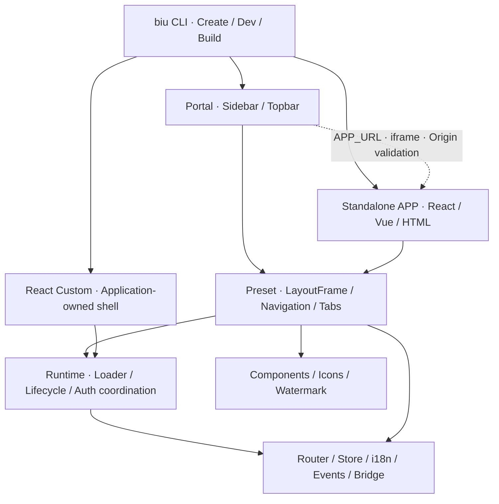
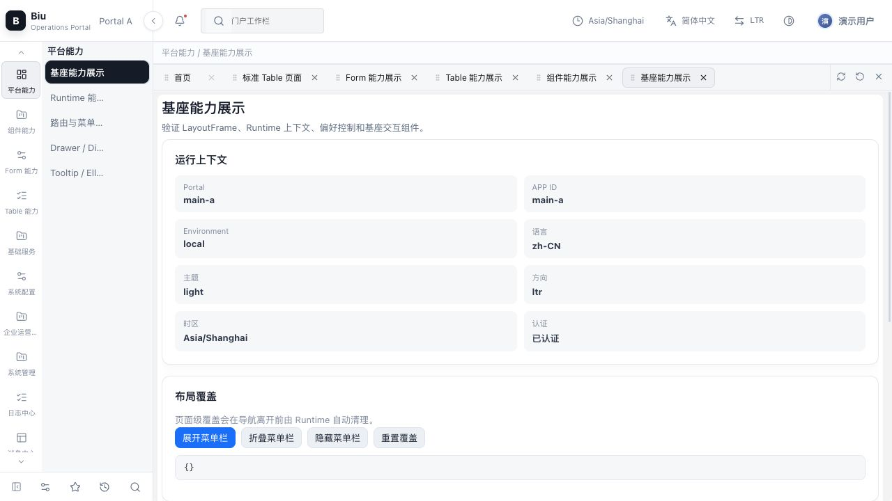
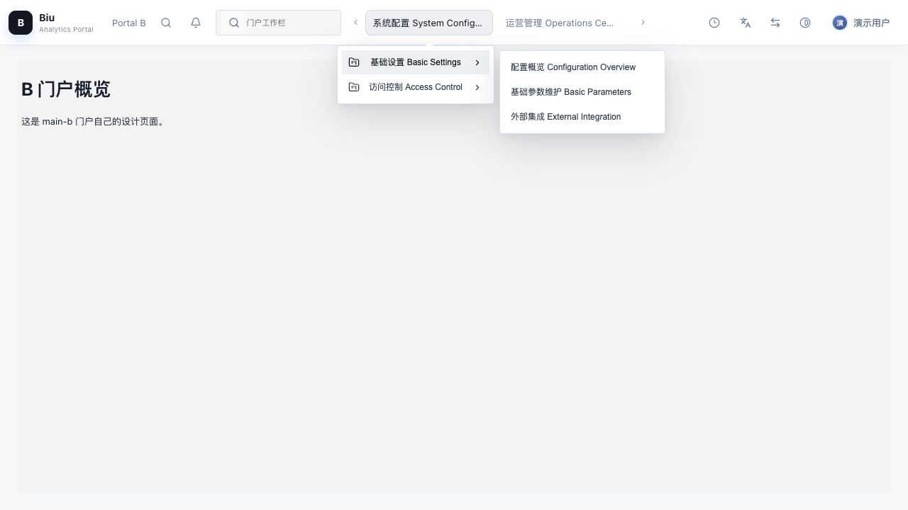
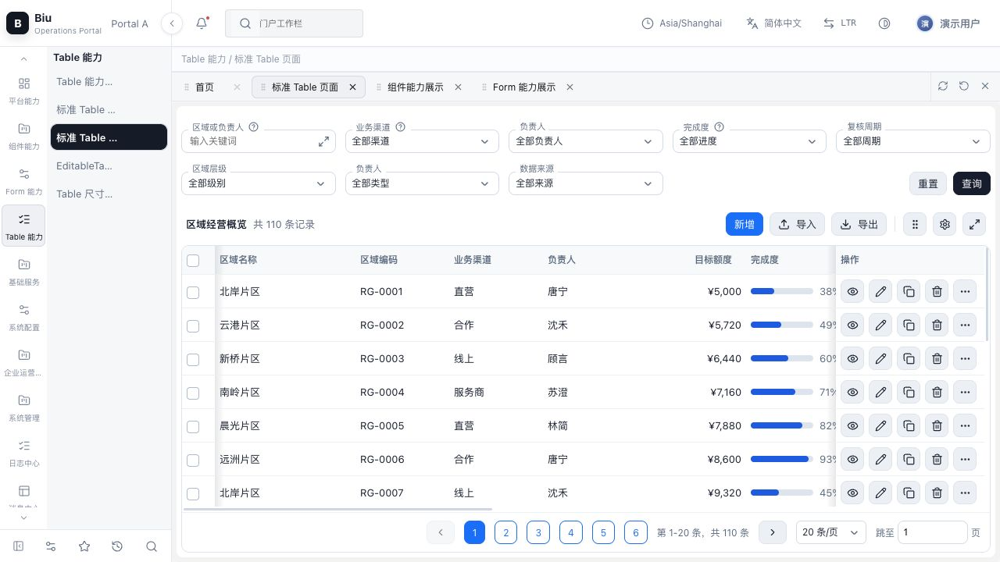
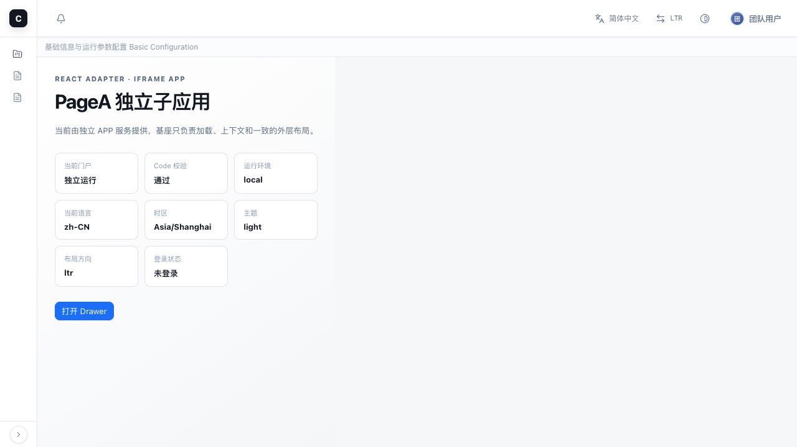
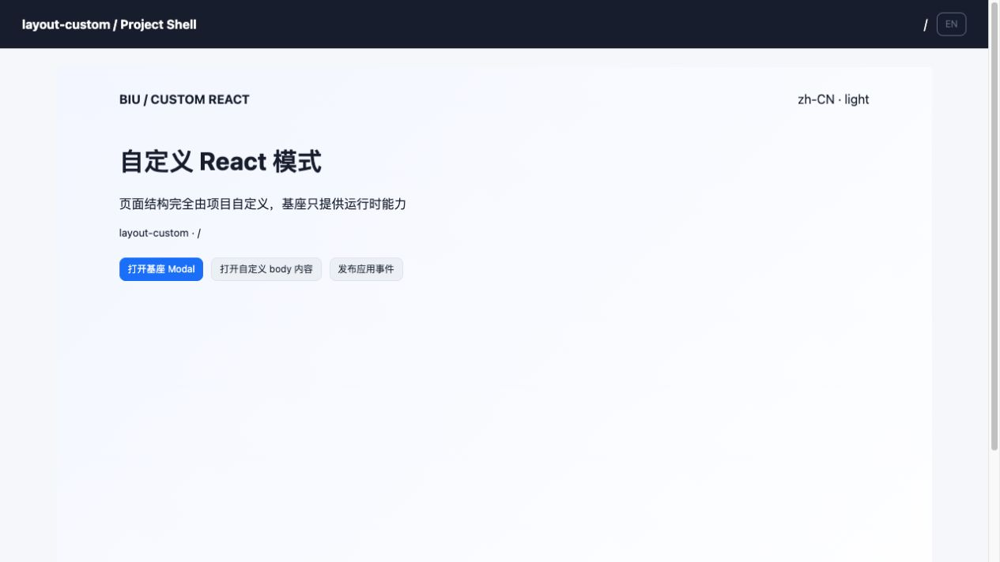

# biu


[中文](README.md) · [Documentation](docs/README.en.md) · [CLI reference](packages/cli/README.md) · [Package graph](docs/en/package-graph.md)

biu is a modular frontend foundation for enterprise Portals, standalone APPs and React Custom shells. The CLI creates, develops and builds projects; Runtime coordinates navigation, lifecycle and cross-window communication; Preset provides shared layouts. Business projects own their pages and APIs.

**Node.js 22+ · pnpm 9.14.4 · TypeScript · Rsbuild/Rspack · React 19 · Zustand**

React uses the official Adapter. Vue, native HTML and existing systems can integrate through iframe or the Adapter Contract. Eighteen public packages provide reusable components, forms, tables, HTTP, Query, localization, events, state, icons, watermarks and logging.

## Run the Demo

From the repository root:

```bash
pnpm install # Local prepare builds public packages/hooks; CI skips root builds
pnpm start --filter main-a -- --apps ../child-app,../vue-child
```

Open the Portal URL printed by the CLI. Default ports are `9001` for Portal A, `8001` for the React APP and `8002` for the Vue APP. When a port is occupied, use the startup log. Start other modes in a separate terminal:

```bash
pnpm start --filter main-b        # Topbar Portal, default 9002
pnpm start --filter html-child    # Native HTML APP
pnpm start --filter layout-custom # React Custom
```

The Portal loads APPs from the current environment's `remoteApps[APP_ID].APP_URL`. `--apps` coordinates local processes and port overrides; production projects build, deploy and roll back independently.

## Projects and packages



This diagram shows usage and coordination. See the [package graph](docs/en/package-graph.md) for actual manifest dependencies. A Portal does not bundle APP page sources; an APP does not modify its host DOM/CSS. Runtime keeps a Loader boundary with iframe as the default.

| Layer       | Packages and responsibilities                                                                                     |
| ----------- | ----------------------------------------------------------------------------------------------------------------- |
| Tooling     | `@biugle/biu-cli`: initialization, menu discovery, page selection, snapshots, development server and builds       |
| Foundation  | `@biugle/biu-runtime`, `@biugle/biu-preset`, `@biugle/biu-adapter-react`                                          |
| Core        | `@biugle/biu-router`, `@biugle/biu-store`, `@biugle/biu-i18n`, `@biugle/biu-events`, `@biugle/biu-bridge`         |
| UI and data | `@biugle/react-components`, `@biugle/react-form`, `@biugle/react-table`, `@biugle/tanstack-query`, `@biugle/http` |
| Utilities   | `@biugle/icons`, `@biugle/render-code`, `@biugle/watermark`, `@biugle/logger`                                     |

Components `/ui` exports primitives; the root and `/pro` export business presets, Chinese defaults and `fire()`. Form has one root entry. Table `/ui` provides the basic structure; its root provides ProTable, EditableTable and `useQueryTable`. Query's root is framework-neutral; React hooks use `/react`. Public React packages require React 19.

## Page previews

These screenshots capture the current Chinese Demo with demonstration text and sanitized mock data. Chinese/English switching checks and capture details are recorded in the [delivery review](docs/en/final-delivery-review.md).

| Sidebar Portal                                   | Topbar Portal                                   |
| ------------------------------------------------ | ----------------------------------------------- |
|  |  |



| Standalone React APP                                    | React Custom                                       |
| ------------------------------------------------------- | -------------------------------------------------- |
|  |  |

Key local Portal A routes:

| Path                                           | Coverage                                                              |
| ---------------------------------------------- | --------------------------------------------------------------------- |
| `/ComponentCapabilities/ComponentUIShowcase`   | UI/Pro, Overlay, Upload and property-by-property API tables           |
| `/FormCapabilities/FormShowcase`               | Form.Item, validation, Form.List and control binding                  |
| `/TableCapabilities/TableShowcase`             | Table, ProTable, editing, queries and column settings                 |
| `/TableCapabilities/StandardTablePageShowcase` | CRUD, 110 mock records, 20 rows per page and additional filter Drawer |
| `/TableCapabilities/StandardTableTabsShowcase` | Tabbed standard pages and page Stores                                 |
| `/TableCapabilities/TableResizeShowcase`       | Column widths, row heights, boundaries, fill and horizontal scrolling |

URLs include the complete menu hierarchy. Use `navigateByKey` for duplicate Codes. Menu paths and page directories use PascalCase, such as `/SystemConfig/SystemBasic/PageA` and `src/pages/PageA`.

## Create projects and use the CLI

Use the current repository CLI:

```bash
pnpm exec biu --help
pnpm exec biu init # Terminal prompts: projects, layouts, auth, menus and slots
pnpm exec biu create my-portal --type PORTAL --preset sidebar
pnpm exec biu create my-app --type APP --preset custom
```

Outside the repository, install a published `@biugle/biu-cli` version and use the same `biu` commands. In a generated project:

```bash
pnpm install
pnpm start
pnpm build              # prod environment, menu-selected pages
pnpm build:all          # Debugging: compile all local pages
pnpm exec biu dev --env dev --port 9101
pnpm exec biu build --env test
```

The CLI provides `init`, `create`, `start`, `dev` and `build`; the deployment environment previews static output. `TARGET` is `APP`/`PORTAL`; `TYPE` is `DIRECTORY`/`MENU`/`COMPONENT`. Runtime menus and permissions take priority. `local-routes` supports development and controlled fallback; `--all` is for diagnosis.

```text
apps/<project>/
├── biu.config.ts
├── config/{local,dev,test,pre,prod}.ts
├── local-routes/index.ts
└── src/pages/<Code>/
```

Use workspace packages for shared code. The foundation owns localization; pages call `useBiuI18n().$t("中文 key")` without creating another `src/i18n`. The CLI generates `.biu/generated` and `.biu/foundation` for local use. Keep them out of Git. After modifying public packages or the CLI, stop services, rebuild and restart to refresh snapshots.

## Validate, build and release

```bash
pnpm verify              # Complete delivery gate
pnpm check               # Public builds and public package / Demo type checks
pnpm test                # Public package and release-origin regressions
pnpm build:demo:all       # All six Demo builds
pnpm verify:boundaries   # Public entries, dependencies, UI/Pro layering and cycles
pnpm verify:source-size  # All code/CSS files <= 800 lines without exceptions
pnpm verify:scenarios    # 100 CLI inputs and 7 preset / environment builds
```

`pnpm verify` also checks 18 package tarballs and unwanted output, real CLI tarball installation/startup outside the repository, React peers, package/Demo boundaries, an exception-free 800-line code/CSS budget, Vercel asset routing, ESLint, Prettier, Knip, production dependencies, build budgets and `git diff --check`. Current results, fixes and the optimization checklist live in the [delivery review](docs/en/final-delivery-review.md).

Changesets manages public package versions. PRs run CI. The main-branch Release workflow runs the complete gate and maintains release PRs; npm publication checks the merged Release PR origin. Vercel's native Git integration deploys Demos. The Demo artifact workflow runs manually when needed.

```bash
pnpm changeset
```

Publication requires repository Secrets and branch rules; see the [release guide](docs/en/release.md). Local verification does not replace production SSO, authorization, CSP, cache, monitoring and rollback acceptance.

## Documentation and hosted Demos

| Document                                                                          | Coverage                                                          |
| --------------------------------------------------------------------------------- | ----------------------------------------------------------------- |
| [Usage](docs/en/usage.md) / [CLI](packages/cli/README.md)                         | Creation, startup, environments, routes and layouts               |
| [Design](docs/en/design.md) / [Package graph](docs/en/package-graph.md)           | Architecture, dependencies and reusable package boundaries        |
| [Capabilities](docs/en/biu-foundation-components-capabilities.md)                 | Components, foundation, APIs, Demos and design contracts          |
| [Data contracts](docs/en/data-contracts.md) / [Adapters](docs/en/adapters.md)     | APIs, Bridge and framework integration                            |
| [Development](docs/en/development.md) / [Contributing](CONTRIBUTING.md)           | Debugging, testing, commits and output cleanup                    |
| [Production checklist](docs/en/production-checklist.md) / [Security](SECURITY.md) | Production ownership and acceptance                               |
| [Release](docs/en/release.md) / [Vercel](docs/en/vercel-deploy.md)                | Changesets, Actions, domains and deployment                       |
| [Delivery review](docs/en/final-delivery-review.md)                               | Current results, optimization checklist, score and external tasks |

Hosted Demos: [Portal A](https://biu-a.biugle.cn) · [Portal B](https://biu-b.biugle.cn) · [React](https://biu-s.biugle.cn) · [Vue](https://biu-vue.biugle.cn) · [HTML](https://biu-html.biugle.cn) · [Custom](https://biu-custom.biugle.cn). Hosted versions may differ from the working tree; deployment settings are in the Vercel guide.

Licensed under [MIT](LICENSE).
