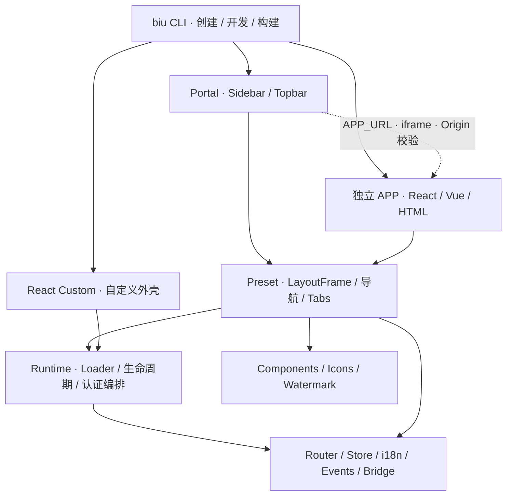

# biu


[English](README.en.md) · [文档中心](docs/README.md) · [CLI 手册](packages/cli/README.md) · [公共包关系图](docs/package-graph.md)

biu 是面向企业 Portal、独立 APP 和 React Custom 的模块化前端基座。CLI 负责创建、开发和构建项目，Runtime 负责菜单路由、生命周期与跨窗口通信，Preset 提供统一布局；业务项目维护自己的页面和接口。

**Node.js 22+ · pnpm 9.14.4 · TypeScript · Rsbuild/Rspack · React 19 · Zustand**

React 使用官方 Adapter；Vue、原生 HTML 和已有系统通过 iframe 或 Adapter Contract 接入。18 个公开包可以按需使用，组件、表单、表格、HTTP、Query、语言、事件、状态、图标、水印和日志可以独立复用。

## 快速运行

在仓库根目录执行：

```bash
pnpm install # 本地 prepare 构建公共包并安装提交钩子，CI 跳过根构建
pnpm start --filter main-a -- --apps ../child-app,../vue-child
```

打开 CLI 输出的 Portal 地址。Demo 默认端口为 Portal A `9001`、React APP `8001`、Vue APP `8002`；端口占用时以启动日志为准。其他模式可在另一个终端启动：

```bash
pnpm start --filter main-b        # Topbar Portal，默认 9002
pnpm start --filter html-child    # 原生 HTML APP
pnpm start --filter layout-custom # React Custom
```

Portal 通过当前环境的 `remoteApps[APP_ID].APP_URL` 加载独立 APP。`--apps` 负责本地启动与端口映射，生产环境仍分别构建、部署和回滚。

## 项目与包的关系



上图表示使用与编排关系；包 manifest 的实际依赖见[公共包关系图](docs/package-graph.md)。Portal 不打包 APP 页面源码，APP 不修改宿主 DOM/CSS；Runtime 保留 Loader 边界，默认使用 iframe。

| 层级      | 包与职责                                                                                                          |
| --------- | ----------------------------------------------------------------------------------------------------------------- |
| 工程      | `@biugle/biu-cli`：初始化、菜单发现、页面筛选、快照、开发服务、构建                                               |
| 基座      | `@biugle/biu-runtime`、`@biugle/biu-preset`、`@biugle/biu-adapter-react`                                          |
| 核心      | `@biugle/biu-router`、`@biugle/biu-store`、`@biugle/biu-i18n`、`@biugle/biu-events`、`@biugle/biu-bridge`         |
| UI 与数据 | `@biugle/react-components`、`@biugle/react-form`、`@biugle/react-table`、`@biugle/tanstack-query`、`@biugle/http` |
| 通用工具  | `@biugle/icons`、`@biugle/render-code`、`@biugle/watermark`、`@biugle/logger`                                     |

Components 的 `/ui` 提供基础组件，根入口与 `/pro` 提供业务预设、默认中文与 `fire()`。Form 只有根入口；Table 的 `/ui` 提供基础结构，根入口提供 ProTable、EditableTable 和 `useQueryTable`。Query 根入口不绑定 React，React hooks 从 `/react` 使用。React 公共包要求 React 19。

## 页面预览

以下是当前仓库中文 Demo 的实际页面截图，只包含演示文案和脱敏 mock 数据。中英文切换验收与截图记录见[交付审计](docs/final-delivery-review.md)。

| Sidebar Portal                                   | Topbar Portal                                   |
| ------------------------------------------------ | ----------------------------------------------- |
|  |  |


| 独立 React APP                                    | React Custom                                       |
| ------------------------------------------------- | -------------------------------------------------- |
|  |  |

本地重点验收入口：

| Portal A 路径                                  | 内容                                                    |
| ---------------------------------------------- | ------------------------------------------------------- |
| `/ComponentCapabilities/ComponentUIShowcase`   | UI/Pro、Overlay、Upload 与逐属性 API 表                 |
| `/FormCapabilities/FormShowcase`               | Form.Item、校验、Form.List 与控件绑定                   |
| `/TableCapabilities/TableShowcase`             | Table、ProTable、编辑、查询与列设置                     |
| `/TableCapabilities/StandardTablePageShowcase` | 单页 CRUD、110 条 mock、默认每页 20 条、更多筛选 Drawer |
| `/TableCapabilities/StandardTableTabsShowcase` | 多 Tab 标准页与页面 Store                               |
| `/TableCapabilities/TableResizeShowcase`       | 列宽、行高、边界、弹性填充与横向滚动                    |

完整 URL 包含菜单层级；重复 Code 使用 `navigateByKey` 定位。菜单与本地目录使用 PascalCase，例如 `/SystemConfig/SystemBasic/PageA` 和 `src/pages/PageA`。

## 创建与使用 CLI

在本仓库使用当前 CLI：

```bash
pnpm exec biu --help
pnpm exec biu init # 终端交互：多个 Portal/APP、布局、认证、菜单来源与插槽
pnpm exec biu create my-portal --type PORTAL --preset sidebar
pnpm exec biu create my-app --type APP --preset custom
```

仓库外使用已发布版本时，可安装 `@biugle/biu-cli`，再执行同样的 `biu` 命令。进入生成项目后：

```bash
pnpm install
pnpm start
pnpm build              # prod 环境，按菜单选择页面
pnpm build:all          # 排查用：编译全部本地页面
pnpm exec biu dev --env dev --port 9101
pnpm exec biu build --env test
```

CLI 提供 `init`、`create`、`start`、`dev`、`build`；静态产物预览由部署环境提供。`TARGET` 为 `APP`/`PORTAL`；`TYPE` 为 `DIRECTORY`/`MENU`/`COMPONENT`。运行时菜单与权限优先，`local-routes` 用于开发和受控 fallback，`--all` 不作为生产默认。

```text
apps/<project>/
├── biu.config.ts
├── config/{local,dev,test,pre,prod}.ts
├── local-routes/index.ts
└── src/pages/<Code>/
```

共享代码放 workspace package。语言资源由基座提供，页面使用 `useBiuI18n().$t("中文 key")`，项目不重复生成 `src/i18n`。开发时 CLI 生成 `.biu/generated` 与 `.biu/foundation`，这些文件不进入 Git。修改公共包或 CLI 后，先停止服务，再构建并重启以更新快照。

## 检查、构建与发布

```bash
pnpm verify              # 完整交付门禁
pnpm check               # 公共包构建 + 公共包 / Demo 类型检查
pnpm test                # 公共包与发布来源回归
pnpm build:demo:all       # 六个 Demo 全量构建
pnpm verify:scenarios    # 100 个 CLI 输入 + 7 种 preset / 环境构建
pnpm verify:boundaries   # 包 / Demo 公开入口、依赖声明、UI/Pro 与循环检查
pnpm verify:source-size  # 全仓库代码与 CSS ≤ 800 行，无豁免
```

`pnpm verify` 还包括 18 个包打包与污染检查、仓库外真实 CLI tarball 安装/启动、React peer 契约、模块边界、代码与 CSS 的 800 行规模限制、Vercel 资源路由、ESLint、Prettier、Knip、生产依赖审计、构建体积预算和 `git diff --check`。最新结果、已修复问题和后续优化清单统一保存在[最终交付审计](docs/final-delivery-review.md)。

公共包通过 Changesets 管理版本。PR 执行 CI；主分支 Release workflow 执行完整门禁并维护版本 PR，npm 发布校验已合并 Release PR 来源。Demo 由 Vercel 原生 Git 部署，Actions 的 Demo artifact 构建按需手动运行。

```bash
pnpm changeset
```

正式发布需要配置仓库 Secrets 和分支规则，详见[发布指南](docs/release.md)。本地回归通过并不代替生产 SSO、权限、CSP、缓存、监控和回滚验收。

## 文档与在线 Demo

| 文档                                                             | 内容                               |
| ---------------------------------------------------------------- | ---------------------------------- |
| [使用](docs/usage.md) / [CLI](packages/cli/README.md)            | 创建、启动、环境、路由和布局       |
| [设计](docs/design.md) / [包关系图](docs/package-graph.md)       | 架构、依赖与独立包边界             |
| [综合能力说明](docs/biu-foundation-components-capabilities.md)   | 组件、基座、API、Demo 与设计契约   |
| [数据契约](docs/data-contracts.md) / [Adapter](docs/adapters.md) | 接口、Bridge、多框架接入           |
| [开发](docs/development.md) / [贡献](CONTRIBUTING.md)            | 调试、测试、提交与产物清理         |
| [生产检查](docs/production-checklist.md) / [安全](SECURITY.md)   | 生产接入责任与验收                 |
| [发布](docs/release.md) / [Vercel](docs/vercel-deploy.md)        | Changesets、Actions、域名与部署    |
| [最终交付审计](docs/final-delivery-review.md)                    | 最新回归、优化清单、评分与外部待办 |

在线 Demo：[Portal A](https://biu-a.biugle.cn) · [Portal B](https://biu-b.biugle.cn) · [React](https://biu-s.biugle.cn) · [Vue](https://biu-vue.biugle.cn) · [HTML](https://biu-html.biugle.cn) · [Custom](https://biu-custom.biugle.cn)。线上版本可能与当前工作树不同，部署配置见 Vercel 指南。

本项目使用 [MIT License](LICENSE)。
