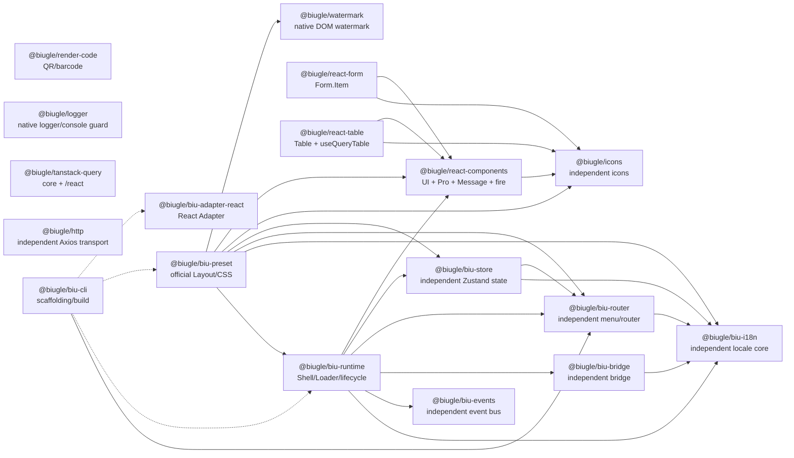

# Public Package Boundaries and Dependency Graph

Public packages are split into independently reusable contracts and foundation orchestration. UI, HTTP, Query and utilities do not depend on Runtime/Preset. Router, Store and Bridge depend only on their lower-level core contracts. Foundation packages compose these capabilities into Portal and APP delivery modes.

Solid arrows show internal package dependencies declared in package.json; dashed arrows show the generated project composition, not CLI or Adapter runtime dependencies.

## Independent packages

- `@biugle/react-components` uses the root for Pro presets and `/ui` for composable UI structures. Its Chinese and English defaults live in local JSON resources; `ConfigProvider` (with the `ComponentsProvider` compatibility alias) and per-component `localeText` overrides are supported.
- `@biugle/render-code` depends only on `qrcode` and `jsbarcode`. It provides native QR, barcode, export and browser-download helpers without React, Vue, Runtime or Preset.
- `@biugle/watermark` is a native DOM/SVG watermark package with multi-line text, styling, update and destroy support. Preset consumes it instead of maintaining a second watermark behavior, and business apps can use it independently.
- `@biugle/logger` is a native JS package for colored multi-argument logs, console guard, best-effort DevTools detection, cancellable debugger modes and throttled Watermark refresh callbacks. It is React-free and Watermark-free, so any front-end framework can use it independently.
- `@biugle/react-form` owns only `react-hook-form` state, validation and `Form.Item` render props; it composes `@biugle/react-components` and `@biugle/icons` for consistent controls and help icons. Its default error-summary title comes from local Chinese/English JSON and can be overridden on `Form` or `FormErrorSummary`.
- `@biugle/react-table` owns table structure, interactions and `useQueryTable`, not a request client; it composes `@biugle/react-components` for filter, action and status controls and accepts caller-owned query functions. It depends on TanStack Table/Virtual and React. Local `dataSource` supports filtering, stable sorting and page slicing; when the server total is larger than the local page, server pagination is preserved. Empty, loading, pagination and accessibility labels come from local JSON and can be overridden on `Table` or `TablePagination`.
- `@biugle/tanstack-query` is one independent Query package: the root (also available as `/core`) depends only on `@tanstack/query-core`; the `/react` subpath provides the Provider and React hooks and keeps React Query as an optional peer dependency. There is no second React Query package, and HTTP remains React-free.
- `@biugle/http` owns the migrated Axios transport, cancellation, retry, upload and lifecycle hooks; it does not depend on Runtime, UI, authentication or Mock data.
- `@biugle/biu-i18n`, `@biugle/biu-events`, `@biugle/biu-bridge`, `@biugle/biu-router` and `@biugle/biu-store` can be used without a React Shell. They own locale, events, cross-window protocol, menu navigation and persisted state respectively.

Preset, Runtime, Adapter and CLI are orchestration packages. Demo applications use public entries and do not duplicate Tooltip, Ellipsis, Dialog, Drawer, Message, Form, Table or Watermark implementations. Chart, RichText, Editor and Preview Server are outside the base packages.

Preset reads locale, menu navigation and preferences directly from the public I18n, Router and Store entries. All three dependencies are declared in its own `package.json`; it does not rely on Runtime forwarding entries or transitive dependency resolution. Store's `auth-store` alone owns authentication state, while `preference-store.auth` remains a compatibility projection.

## Automated boundary gates

`pnpm verify:boundaries` checks source imports and dependencies for public packages, Demos and the shared Demo package:

- Internal package imports, re-exports and literal dynamic imports must match the target package's `exports`. Production source dependencies must be declared in `dependencies` or `peerDependencies`, rather than resolved through `devDependencies` or transitive dependencies.
- Cross-package and cross-Demo imports must use public entries; relative access to another package's source is forbidden.
- `react-components` and `react-table` UI must not import Pro. Reusable packages must not depend on the Runtime, Preset, Adapter or CLI orchestration layer.
- Both package dependency and relative source import graphs must be acyclic. Type imports and type re-exports are included in source checks.

`pnpm verify:source-size` also applies an 800-line limit to JS/TS/CSS source, tests and scripts, with no exception baseline. Generated output and data resources such as JSON are excluded from the source count. Both gates run before the remaining checks in the complete `pnpm verify` workflow.

## React runtime version

All public React packages require `react: ^19.0.0`; packages that render DOM also declare `react-dom: ^19.0.0`. Icons and Query do not require ReactDOM. React and ReactDOM are peer dependencies; workspace test versions live in devDependencies so package installation does not resolve a second React copy beside the host. The React peers of `@biugle/tanstack-query` remain optional, so its core entry does not require React.
