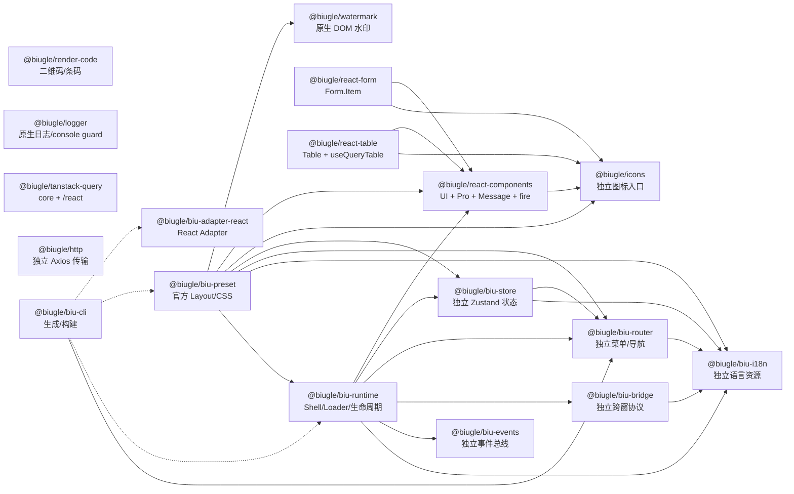

# 公共包边界与依赖关系

仓库中的公共包按“可独立复用”和“基座编排”分开。UI、HTTP、Query 和通用工具不依赖 Runtime/Preset；Router、Store、Bridge 仅依赖相应的下层核心包。基座包把这些能力组合成 Portal/APP 运行形态。

实线表示 package.json 声明的内部包依赖；虚线表示生成项目的组合关系，不代表 CLI 或 Adapter 的运行时依赖。

## 独立包说明

- `@biugle/react-components` 的根入口是 Pro 预设，`@biugle/react-components/ui` 是 UI 结构入口。组件包只依赖图标、React 和自身的视觉运行时；默认文案由 `src/locale/zh-CN.json` 与 `src/locale/en-US.json` 管理，`ConfigProvider`（兼容别名 `ComponentsProvider`）或组件 `localeText` 可以覆写。
- `@biugle/render-code` 只依赖 `qrcode` 与 `jsbarcode`，提供原生 QRCode、Barcode、导出和浏览器下载方法，不绑定 React、Vue、Runtime 或 Preset。
- `@biugle/watermark` 是原生 DOM/SVG 水印包，支持多行文案、样式、更新和销毁；Preset 只消费它，不复制另一套水印行为，业务也可以独立使用。
- `@biugle/logger` 是原生 JS 日志、console guard 和最佳努力 DevTools 检测包，支持彩色多参数日志、console 恢复、可取消 debugger 以及节流的 Watermark 刷新回调；它不依赖 React 或 Watermark，可独立用于任意前端框架。
- `@biugle/react-form` 只负责 `react-hook-form` 状态、校验和 `Form.Item` render props，不拥有接口请求；使用 `@biugle/react-components` 和 `@biugle/icons` 组合统一控件/提示图标。默认错误汇总标题来自本包的中英文 JSON，可通过 `Form locale/localeText` 或 `FormErrorSummary` 参数覆盖。
- `@biugle/react-table` 只负责表格结构、交互和 `useQueryTable`，不拥有请求客户端；使用 `@biugle/react-components` 组合筛选、操作和状态控件，通过查询函数参数接入调用方的请求客户端。它依赖 TanStack Table/Virtual 和 React；本地 `dataSource` 支持筛选、稳定排序和分页裁切，服务端总数大于本地数据量时保留服务端分页；默认空态、加载态、分页和无障碍文案来自本包 JSON，可通过 `Table locale/localeText` 或 `TablePagination` 参数覆盖。
- `@biugle/tanstack-query` 是一个独立的单包 Query 标准层：root（也可从 `/core` 使用）只依赖 `@tanstack/query-core`，`/react` 子路径才提供 Provider 和 React hooks，并将 React Query 保持为可选 peer dependency；不新增第二个 React Query 包，也不让 HTTP 依赖 React。
- `@biugle/http` 只负责迁移后的 Axios 传输、取消、重试、上传和生命周期钩子；它不依赖 Runtime、UI、认证或 Mock。
- `@biugle/biu-i18n`、`@biugle/biu-events`、`@biugle/biu-bridge`、`@biugle/biu-router` 和 `@biugle/biu-store` 都可以脱离 React Shell 单独使用。它们分别维护语言、事件、跨窗口协议、菜单导航和状态持久化边界。

Preset、Runtime、Adapter 和 CLI 是基座编排层。Demo 只使用公开入口，不复制 Tooltip、Ellipsis、Dialog、Drawer、Message、Form、Table 或 Watermark 的第二套实现。Chart、RichText、Editor 和 Preview Server 不属于基础包。

Preset 直接从 I18n、Router、Store 的公开入口读取语言、菜单导航和偏好状态，三条依赖都由自身 `package.json` 声明；不依赖 Runtime 的转发入口或间接依赖解析。认证状态只由 Store 的 `auth-store` 管理，`preference-store.auth` 保留为兼容投影。

## 自动边界门禁

`pnpm verify:boundaries` 检查公共包、Demo 与共享 Demo 包的源码导入和依赖关系：

- 内部包的 import、re-export 和字面量动态 import 和 import 类型表达式必须命中目标包的 `exports`；生产源码依赖必须在 `dependencies` 或 `peerDependencies` 声明，不能靠 `devDependencies` 或间接依赖解析。
- 跨包、跨 Demo 必须使用公开入口，禁止相对路径访问另一包的源码。
- `react-components` 与 `react-table` 的 `ui` 不得反向导入 `pro`；独立包不得依赖 Runtime、Preset、Adapter 或 CLI 编排层。
- 包依赖图和源码导入图都必须无循环；类型导入及类型 re-export 也纳入源码检查。

`pnpm verify:source-size` 同时对 JS/TS/CSS 源码、测试和脚本执行 800 行上限，不保留例外基线。生成产物与 JSON 等数据资源不参与源码行数统计；这两个门禁都属于完整 `pnpm verify` 的前置检查。

## React 运行时版本

所有 React 公共包统一要求 `react: ^19.0.0`；需要 DOM 渲染的包同时声明 `react-dom: ^19.0.0`。Icons 与 Query 不要求 ReactDOM。React 和 ReactDOM 只声明为 peer dependency，工作区测试版本放在 devDependency，避免安装公共包时在宿主之外再解析一份 React。`@biugle/tanstack-query` 的 React peer 仍为可选项，使用 core 入口不需要安装 React。
